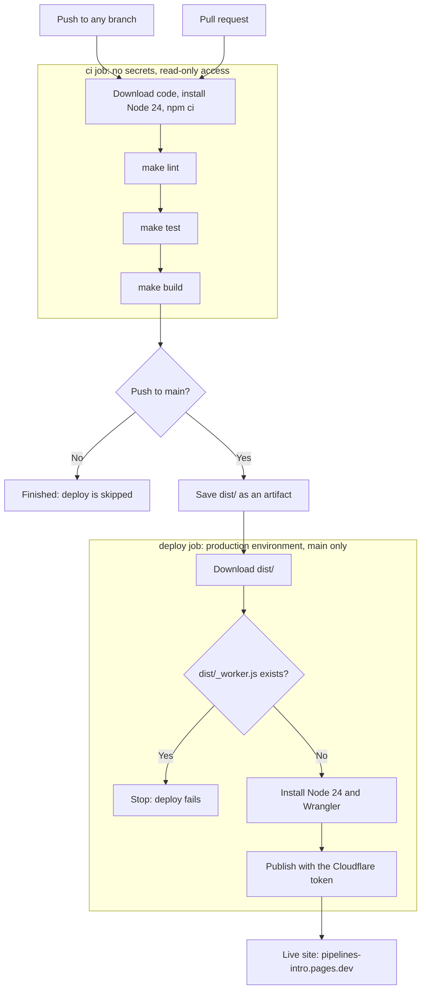

# Pipeline

How a change gets from a push to the live site. This describes `.github/workflows/ci.yml`, and any PR that changes the workflow updates this page too, so the PR's diff shows what changed.

A failure at any step stops the run, and later steps and jobs don't run. "Save dist/" is the last step of the `ci` job, so `deploy` only starts if all of `ci` passed.

## What runs when

| Event | `ci` | Save `dist/` | `deploy` |
|---|---|---|---|
| Push to a branch | Runs as `ci (push)` | Skipped | Skipped |
| Pull request | Runs as `ci (pull_request)`, on the branch merged with `main` | Skipped | Skipped |
| Merge to `main` | Runs as `ci (push)` | Runs | Runs if `ci` passed |

## Rules around the pipeline

These are repo settings, not part of the workflow file:

- **`main`:** needs a PR and a passing `ci (pull_request)` check, with the branch up to date and no bypassing. Only squash-merging is allowed.
- **`production` environment:** holds `CLOUDFLARE_API_TOKEN` and `CLOUDFLARE_ACCOUNT_ID`, and only `main` can use it, with no admin bypass.
- **Allowed actions:** GitHub-owned ones, plus `cloudflare/wrangler-action`.
- **Fork PRs:** workflow runs need approval, and they get no secrets.
