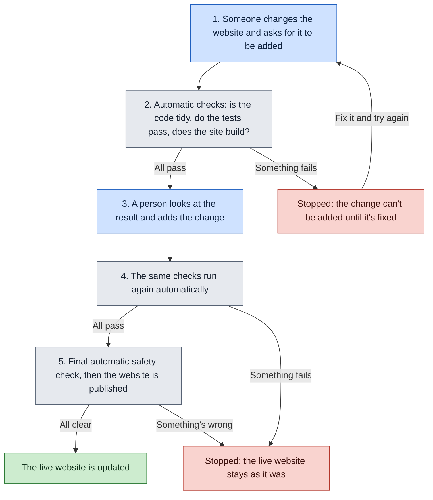
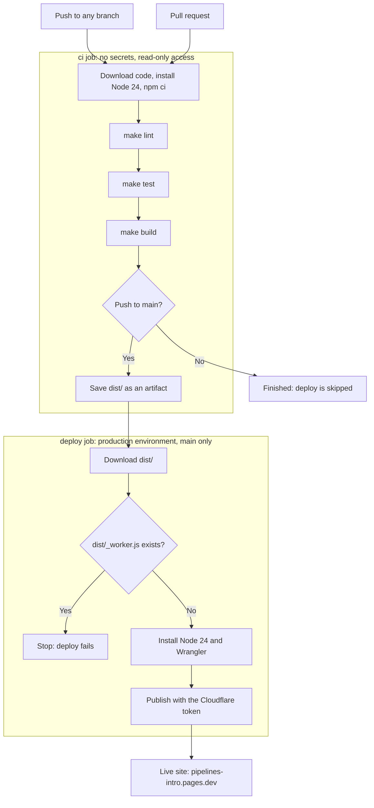

# Pipeline

How a change gets onto the live website. Any PR that changes the workflow updates this page too, so the PR shows what changed.

## In plain English

**Blue:** done by a person. **Grey:** happens automatically. **Green:** the result. **Red:** stopped, and nothing reaches the live website.

The main idea is that nothing goes live unless the automatic checks pass, and nobody can skip them, including the repo owner.

## Plain words and technical terms

| In plain English | The technical term |
|---|---|
| Asking for a change to be added | Opening a pull request (PR) |
| The automatic checks | The `ci` job: `make lint`, `make test`, `make build` |
| Adding the change | Squash-merging the PR into `main` |
| Is the code tidy? | Lint |
| Do the tests pass? | Unit tests |
| Does the site build? | The build, which creates `dist/` |
| Final safety check | Refusing `dist/_worker.js` |
| Publishing the website | The `deploy` job uploading to Cloudflare Pages |

## In technical terms

A failure at any step stops the run, and later steps and jobs don't run. "Save dist/" is the last step of the `ci` job, so `deploy` only starts if all of `ci` passed.

### What runs when

| Event | `ci` | Save `dist/` | `deploy` |
|---|---|---|---|
| Push to a branch | Runs as `ci (push)` | Skipped | Skipped |
| Pull request | Runs as `ci (pull_request)`, on the branch merged with `main` | Skipped | Skipped |
| Merge to `main` | Runs as `ci (push)` | Runs | Runs if `ci` passed |

### Rules around the pipeline

These are repo settings, not part of the workflow file:

- **`main`:** needs a PR and a passing `ci (pull_request)` check, with the branch up to date and no bypassing. Only squash-merging is allowed.
- **`production` environment:** holds `CLOUDFLARE_API_TOKEN` and `CLOUDFLARE_ACCOUNT_ID`, and only `main` can use it, with no admin bypass.
- **Allowed actions:** GitHub-owned ones, plus `cloudflare/wrangler-action`.
- **Fork PRs:** workflow runs need approval, and they get no secrets.
